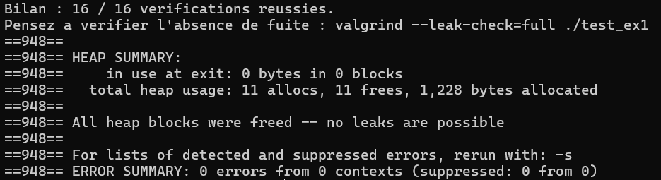
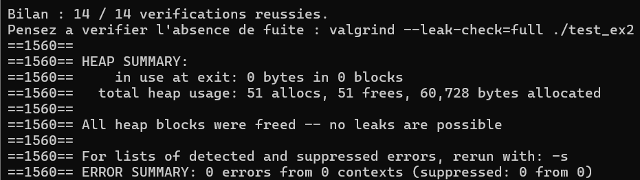
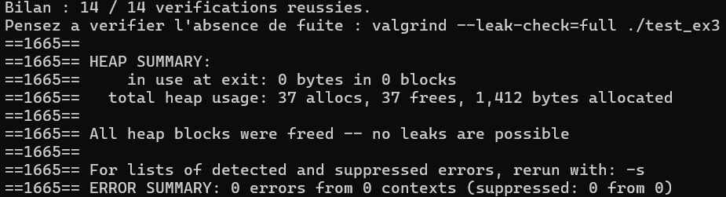
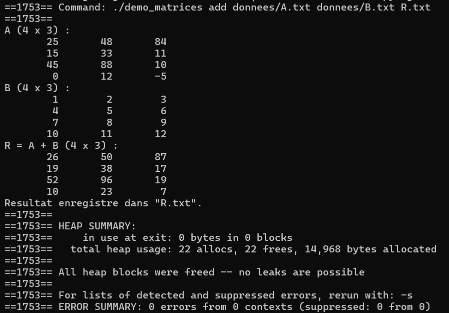
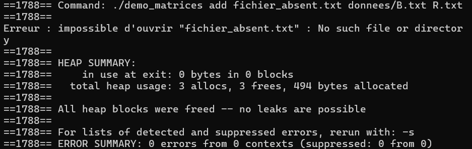
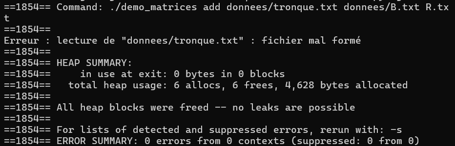
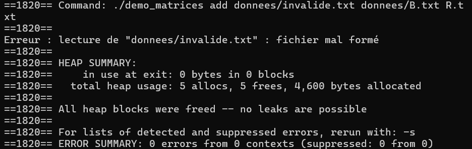
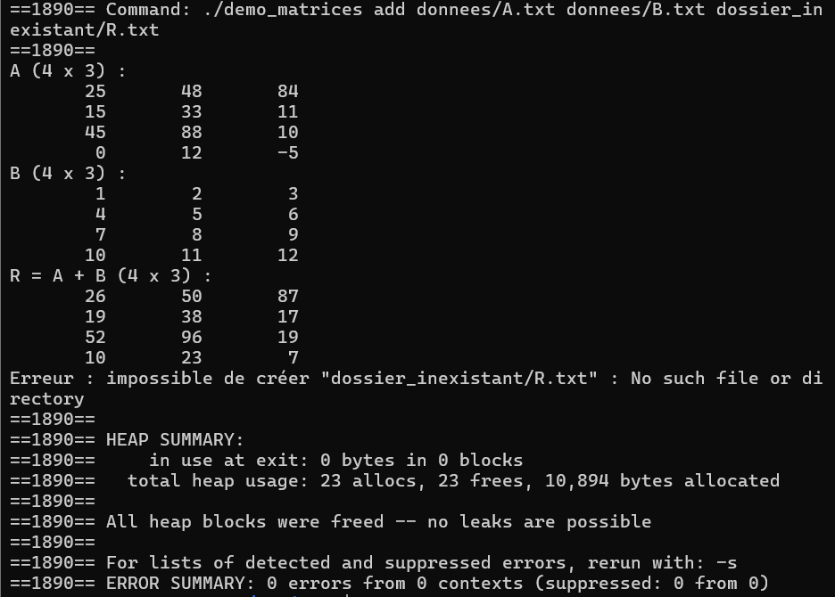

# Compte rendu — TD Matrices en C

## 1. En-tête
* **Titre :** TD Manipulation de matrices dynamiques en C11
* **Membres :** Delépine Bastien (`@bdelepine1`) et Delporte William (`@Willdel09`)
* **Groupe :** TD1
* **Date de remise :** ???

### Table des matières
1. [En-tête](#1-en-tête)
2. [Introduction](#2-introduction)
3. [Conception](#3-conception)
4. [Réalisation, exercice par exercice](#4-réalisation-exercice-par-exercice)
5. [Vérifications mémoire](#5-vérifications-mémoire)
6. [Démonstration finale](#6-démonstration-finale)
7. [Bilan et difficultés](#7-bilan-et-difficultés)
8. [Annexes](#annexes)

---

## 2. Introduction
Développement d'une bibliothèque permettant la création, l'allocation dynamique, la manipulation (i/o) et les calculs arithmétiques (addition, multiplication) sur des matrices d'entiers.

**État de réalisation à la remise :**
* Exercices 1 à 3 : 100 % fonctionnels (validation par les tests de chaque question et Valgrind OK).
* Programme principal demo_matrices : 100 % fonctionnel (exécution des calculs, gestion des arguments et affichage de messages d'erreur explicites).

---

## 3. Conception

### Schéma des modules
```text
                      ┌──────────┐
                      │  main.c  │
                      └────┬─────┘
           ┌───────────────┼───────────────┐
           │               │               │
           ▼               ▼               │
    ┌─────────────┐ ┌─────────────┐        │
    │ matrice_    │ │ matrice_    │        │
    │ calcul.c    │ │ io.c        │        │
    └──────┬──────┘ └──────┬──────┘        │
           │               │               │
           └───────────────┼───────────────┘
                           ▼
                    ┌─────────────┐
                    │ matrice_    │
                    │ alloc.c     │
                    └─────────────┘

```
### Graphe des inclusions et garde `#ifndef`

#### 1. Graphe des inclusions

Le fichier d'en-tête `matrice.h` contient la définition de la structure `Matrice`, les différentes `MatErreur`, la constante de dimension (`MAT_DIM_MAX`) ainsi que les prototypes de l'ensemble des fonctions.

Chaque code source inclut cet en-tête pour accéder aux types et aux différentes fonctions :

```text

                     ┌───────────────┐
                     │   matrice.h   │
                     └───────▲───────┘
                             │
     ┌───────────────┬───────┼───────┬───────────────┬───────────────┐
     │               │               │               │               │
┌────┴─────┐   ┌─────┴─────┐   ┌─────┴─────┐   ┌─────┴─────┐   ┌─────┴─────┐
│matrice.c │   │matrice_   │   │matrice_   │   │matrice_   │   │  main.c   │
│          │   │alloc.c    │   │io.c       │   │calcul.c   │   │(et tests) │
└──────────┘   └───────────┘   └───────────┘   └───────────┘   └───────────┘
```

### 2. justification du garde `#ifndef`

Tous les fichiers .c incluent matrice.h, la directive #ifndef MATRICE_H avant le #define MATRICE_H dans matrice.h empêche les inclusions multiples lors de la compilation.

### Règles de propriété de la mémoire

- **Règle R1 — Allocation (`mat_allouer`) :**
  - La fonction alloue dynamiquement la mémoire.
  - En cas d'échec intermédiaire, toutes les ressources déjà allouées sont libérées.
  - La matrice transmise est remise à l'état `MATRICE_VIDE`.
- **Règle R2 — Responsabilité et propriété :**
  - La fonction appelante devient le seul propriétaire de la mémoire allouée.
  - Elle est aussi la seule responsable de sa libération.
- **Règle R3 — Libération (`mat_detruire`) :**
  - Tout appel réussi à `mat_allouer` doit être associé avec un appel à `mat_detruire`.
  - La libération remet la structure à `MATRICE_VIDE`.

### Justifications techniques

- **Détection des dépassements d'entier :**
  - **Problème :** Les calculs sur des `int` peuvent dépasser `INT_MAX` ou `INT_MIN` sans déclencher d'erreur système, dans ce cas le résultat retourner est complètement faux.
  - **Solution :** Les additions et multiplications sont calculées temporairement dans un type qui permet des valeurs limites plus étendues.
  - **Contrôle de valeurs :** La fonction `tient_dans_int()` vérifie que le résultat intermédiaire reste bien dans l'intervalle `[INT_MIN, INT_MAX]`.
  - **Action :** En cas de dépassement, la matrice en cours de construction est détruite et la fonction renvoie `MAT_ERR_DEPASSEMENT`.

- **Gestion des échecs d'allocation partielle :**
  - **Problème :** L'allocation se fait en deux temps (le tableau de pointeurs, puis chaque ligne). Si l'allocation de la N-ième ligne échoue, les N-1 lignes précédentes restent bloquées en mémoire.
  - **Solution :** Interception immédiate de chaque retour `NULL` renvoyé par `malloc`.
  - **Nettoyage :** Une boucle désalloue proprement les lignes déjà créées, puis libère le tableau principal de pointeurs.
  - **Finalisation :** La structure est remise à `MATRICE_VIDE` et renvoie `MAT_ERR_ALLOCATION` sans laisser aucune fuite mémoire.

### Contenue du Makefile

```makefile
CC = gcc
CFLAGS = -std=c11 -Wall -Wextra -Wpedantic -g -DMAT_TEST_ALLOC

# Tous les modules du projet
MODULES = matrice.c matrice_alloc.c matrice_io.c matrice_calcul.c

# all : crée les exécutables de tous les tests et du programme principal
all: test_ex1 test_ex2 test_ex3 demo_matrices

# test_ex1 : compile les modules de l'exercice 1
test_ex1: test_ex1.c matrice.c matrice_alloc.c
	$(CC)$(CFLAGS) $^ -o$@

# test_ex2 : compile les modules des exercices 1+2
test_ex2: test_ex2.c matrice.c matrice_alloc.c matrice_io.c
	$(CC)$(CFLAGS) $^ -o$@

# test_ex3 : compile les modules des exercices 1+2+3 
test_ex3: test_ex3.c $(MODULES)
	$(CC)$(CFLAGS) $^ -o$@

# demo_matrices : compile le programme principal
demo_matrices: main.c $(MODULES)
	$(CC)$(CFLAGS) $^ -o$@

# Supprime tous les exécutables créés et le fichier de sortie temporaire créer par l'exécution de test_ex2
clean:
	rm -f test_ex1 test_ex2 test_ex3 demo_matrices test_ex2_sortie.txt
```

## 4. Réalisation, exercice par exercice

---

### Exercice 1 : Allocation et destruction (`matrice.c`, `matrice_alloc.c`)

#### Code écrit et commenté

```c
/* (1.a) */

case MAT_ERR_DIMENSIONS:  return "dimensions incompatibles"; /* Dans le cas de MAT_ERR_DIMENSIONS on renvoie "dimensions incompatibles" */
case MAT_ERR_DEPASSEMENT: return "erreur de dépassement";  /* Dans le cas de MAT_ERR_DEPASSEMENT on renvoie "erreur de dépassement */

/* (1.b) */

return m != NULL && m->coef != NULL && m->nb_lignes >= 1 && m->nb_lignes <= MAT_DIM_MAX && m->nb_colonnes >= 1 && m->nb_colonnes <= MAT_DIM_MAX; 
/* renvoie 1 si les QUATRE conditions suivantes sont vraies, 0 sinon :
     * - m n'est pas NULL ;
     * - m->coef n'est pas NULL ;
     * - 1 <= m->nb_lignes <= MAT_DIM_MAX ;
     * - 1 <= m->nb_colonnes <= MAT_DIM_MAX.
*/
/* (1.c) */

if ((nb_lignes < 1) || (nb_lignes > MAT_DIM_MAX) || (nb_colonnes < 1) || (nb_colonnes > MAT_DIM_MAX))
    return MAT_ERR_ARGUMENT;
/* si nb_lignes ou nb_colonnes n'est pas compris entre 1 et MAT_DIM_MAX, renvoyer MAT_ERR_ARGUMENT. */

/* (1.d) */

for (int i = 0; i < nb_lignes; i++) {
        coef[i] = mat_calloc((size_t)nb_colonnes, sizeof *coef[i]);    // nb_colonnes entiers
        if (coef[i] == NULL) {
            for (int k = i - 1; k >= 0; k--)  // lignes déjà obtenues
                free(coef[k]);
            free(coef);                       // puis le tableau
            return MAT_ERR_ALLOCATION;
        }
}

/* (1.e) */

res->coef = coef;
res->nb_lignes = nb_lignes;
res->nb_colonnes = nb_colonnes;
return MAT_OK;
/* On affecte a notre nouvelle matrice ces coefficients, son nombre de lignes et son nombre de colonnes */

/* (1.f) */

if (m->coef != NULL){
    for (int i=0;i < m->nb_lignes ; i++){
        free(m->coef[i]);
    }
    free(m->coef);
}
/* si m->coef n’est pas NULL, une boucle for libère m->coef[i] pour i allant de 0 à m->nb_lignes - 1, puis on libère m->coef */
```

#### Réponse aux questions de réflexion

**Q3.1** : mat_detruire prend un pointeur Matrice *m pour pouvoir modifier directement la structure. Avec un passage par valeur (Matrice m), seule une copie locale serait modifiée : la mémoire dynamique serait bien libérée, mais la variable de l'appelant conserverait un pointeur obsolète.

**Q3.2** : Pour une matrice n*p, il faut 1 + n allocations (1 pour le tableau de pointeurs principal et n pour chaque ligne) et 1 + n libérations. Si la k-ième allocation de ligne échoue, la fonction doit effectuer k libérations : les k-1 lignes allouées précédemment, puis le tableau de pointeurs principal.

**Q3.3** : mat_detruire remet la structure à MATRICE_VIDE. Lorsque on appele une 2e fois la fonction, la condition if (m->coef != NULL) est fausse et la fonction ne fait rien. Par contre, si on fait une copie (Matrice b = a;), a et b partagent la même adresse. Un premier appel mat_detruire(&a) libère la mémoire, mais b.coef conserve cette adresse : l'appel mat_detruire(&b) échoue.

**Q3.4** : si la fonction échoue en cours de route, l'utilisateur récupère une matrice vide

#### Sortie du test

```text
=== Exercice 1 : matrice.c ===
[OK]    (1.a) message pour MAT_ERR_DIMENSIONS
[OK]    (1.a) message pour MAT_ERR_DEPASSEMENT
[OK]    (1.b) une matrice 1 x 2 est valide
[OK]    (1.b) NULL n'est pas valide
[OK]    (1.b) MATRICE_VIDE n'est pas valide
[OK]    (1.b) une matrice de 0 ligne n'est pas valide
=== Exercice 1 : matrice_alloc.c ===
[OK]    (1.c) mat_allouer refuse 0 ligne
[OK]    (1.c) mat_allouer refuse -2 colonnes
[OK]    (1.c) mat_allouer refuse une dimension > MAT_DIM_MAX
[OK]    (1.e) mat_allouer(&m, 3, 4) renvoie MAT_OK
[OK]    (1.e) m a 3 lignes et 4 colonnes
[OK]    (1.d) tous les coefficients valent 0
[OK]    (1.f) apres mat_detruire, m est vide
[OK]    (1.f) un second mat_detruire est sans danger
[OK]    (1.f) mat_detruire(NULL) ne plante pas
=== Exercice 1 : echecs d'allocation simules ===
[OK]    (1.d) chaque echec renvoie MAT_ERR_ALLOCATION et laisse *res vide

Bilan : 16 / 16 verifications reussies.
```

### Exercice 2 : Entrées-sorties

#### Code écrit et commenté

```c

```

#### Réponses aux questions de réflexion

**Q4.1** :

**Q4.2** :

**Q4.3** :

**Q4.4** :

#### Sortie du test

```text
=== Exercice 2 : affichage (verification visuelle) ===
M (4 x 3) :
        1        2        3
        4        5        6
        7        8        9
       10       11       12
(2.a) Vous devez voir ci-dessus 4 lignes : 1 2 3 / 4 5 6 / 7 8 9 / 10 11 12
=== Exercice 2 : ecriture ===
[OK]    ouverture de test_ex2_sortie.txt en ecriture
[OK]    (2.b) mat_ecrire renvoie MAT_OK
[OK]    (2.b) le fichier contient exactement le format attendu
[OK]    (2.b) mat_ecrire refuse une matrice vide
=== Exercice 2 : relecture ===
[OK]    (2.f) mat_lire relit le fichier : MAT_OK
[OK]    (2.e) la matrice relue est identique
[OK]    (2.e) espaces et sauts de ligne en trop sont toleres
=== Exercice 2 : fichiers incorrects ===
[OK]    (2.c) fichier vide
[OK]    (2.c) dimension nulle
[OK]    (2.c) dimension negative
[OK]    (2.e) coefficient manquant
[OK]    (2.e) donnee non numerique
[OK]    (2.e) entier trop grand pour un int
=== Exercice 2 : echec d'allocation simule ===
[OK]    (2.d) mat_lire renvoie MAT_ERR_ALLOCATION proprement

Bilan : 14 / 14 verifications reussies.
```

### Exercice 3 : Calcul matriciel

#### code écrit et commenté

```c

```

#### Réponses aux questions de réflexion

**Q5.1** :

**Q5.2** :

**Q5.3** :

**Q5.4** :

#### Sortie du test

```text
=== Exercice 3 : addition ===
[OK]    (3.a) (2 x 3) + (3 x 2) : MAT_ERR_DIMENSIONS
[OK]    (3.d) (2 x 3) + (2 x 3) : MAT_OK
[OK]    (3.c) a + b est correct
[OK]    a et b n'ont pas ete modifiees
[OK]    (3.b) le resultat possede sa propre memoire
[OK]    (3.c) INT_MAX + 1 : MAT_ERR_DEPASSEMENT
=== Exercice 3 : multiplication ===
[OK]    (3.e) (2 x 3) x (2 x 3) : MAT_ERR_DIMENSIONS
[OK]    (3.h) (2 x 3) x (3 x 2) : MAT_OK
[OK]    (3.g) a x c = (58 64 / 139 154)
[OK]    (3.f) (3 x 2) x (2 x 3) donne une matrice 3 x 3
[OK]    a et c n'ont pas ete modifiees
[OK]    (3.g) 2 x 10^10 depasse INT_MAX : MAT_ERR_DEPASSEMENT
=== Exercice 3 : cas particuliers ===
[OK]    resultat = entree refuse, a reste intacte
[OK]    (3.f) echec d'allocation : MAT_ERR_ALLOCATION, r vide

Bilan : 14 / 14 verifications reussies.
```

### Exercice 4 : Démonstration complète

#### code écrit et commenté

```c

```

#### Réponses aux questions de réflexion

**Q6.1** :

**Q6.2** :

**Q6.3** :

#### Sortie des scénarios

Fais en Partie 6 dans la démonstration finale

## 5. Vérifications mémoire

### test_ex1 :


### test_ex2 :


### test_ex3 :


### Un des cas valide de demo_matrices :


### Dans le cas du fichier absent :


### Dans le cas du fichier tronque :


### Dans le cas d'un fichier absent :


### Dans le cas d'un dossier inexistant :


## 6. Démonstration finale

### 1er scénario :
```text
user@LAPTOP-MPVMP4JS:~/Projet_C$ ./demo_matrices add donnees/A.txt donnees/B.txt R.txt
A (4 x 3) :
       25       48       84
       15       33       11
       45       88       10
        0       12       -5
B (4 x 3) :
        1        2        3
        4        5        6
        7        8        9
       10       11       12
R = A + B (4 x 3) :
       26       50       87
       19       38       17
       52       96       19
       10       23        7
Resultat enregistre dans "R.txt".
user@LAPTOP-MPVMP4JS:~/Projet_C$ echo $?
0
```
Résultat conforme au résultat attendue

### 2ème scénario :
```text
user@LAPTOP-MPVMP4JS:~/Projet_C$ ./demo_matrices mul donnees/A.txt donnees/C.txt R.txt
A (4 x 3) :
       25       48       84
       15       33       11
       45       88       10
        0       12       -5
B (3 x 2) :
        1        0
        0        1
        2       -1
R = A x B (4 x 2) :
      193      -36
       37       22
       65       78
      -10       17
Resultat enregistre dans "R.txt".
user@LAPTOP-MPVMP4JS:~/Projet_C$ echo $?
0
```
Résultat conforme au résultat attendue

### 3ème scénario :
```text
user@LAPTOP-MPVMP4JS:~/Projet_C$ ./demo_matrices add donnees/A.txt donnees/C.txt R.txt
A (4 x 3) :
       25       48       84
       15       33       11
       45       88       10
        0       12       -5
B (3 x 2) :
        1        0
        0        1
        2       -1
Erreur : calcul impossible : dimensions incompatibles (A : 4 x 3, B : 3 x 2)
user@LAPTOP-MPVMP4JS:~/Projet_C$ echo $?
1
```
Résultat conforme au résultat attendue

### 4ème scénario :
```text
user@LAPTOP-MPVMP4JS:~/Projet_C$ ./demo_matrices mul donnees/A.txt donnees/B.txt R.txt
A (4 x 3) :
       25       48       84
       15       33       11
       45       88       10
        0       12       -5
B (4 x 3) :
        1        2        3
        4        5        6
        7        8        9
       10       11       12
Erreur : calcul impossible : dimensions incompatibles (A : 4 x 3, B : 4 x 3)
user@LAPTOP-MPVMP4JS:~/Projet_C$ echo $?
1
```
Résultat conforme au résultat attendue

### 5ème scénario :
```text
user@LAPTOP-MPVMP4JS:~/Projet_C$ ./demo_matrices add fichier_absent.txt donnees/B.txt R.txt
Erreur : impossible d'ouvrir "fichier_absent.txt" : No such file or directory
user@LAPTOP-MPVMP4JS:~/Projet_C$ echo $?
1
```
Résultat conforme au résultat attendue

### 6ème scénario :
```text
user@LAPTOP-MPVMP4JS:~/Projet_C$ ./demo_matrices add donnees/invalide.txt donnees/B.txt R.txt
Erreur : lecture de "donnees/invalide.txt" : fichier mal formé
user@LAPTOP-MPVMP4JS:~/Projet_C$ echo $?
1
```
Résultat conforme au résultat attendue

### 7ème scénario :
```text
user@LAPTOP-MPVMP4JS:~/Projet_C$ ./demo_matrices add donnees/tronque.txt donnees/B.txt R.txt
Erreur : lecture de "donnees/tronque.txt" : fichier mal formé
user@LAPTOP-MPVMP4JS:~/Projet_C$ echo $?
1
```
Résultat conforme au résultat attendue

### 8ème scénario :
```text
user@LAPTOP-MPVMP4JS:~/Projet_C$ ./demo_matrices add donnees/A.txt donnees/B.txt dossier_inexistant/R.txt
A (4 x 3) :
       25       48       84
       15       33       11
       45       88       10
        0       12       -5
B (4 x 3) :
        1        2        3
        4        5        6
        7        8        9
       10       11       12
R = A + B (4 x 3) :
       26       50       87
       19       38       17
       52       96       19
       10       23        7
Erreur : impossible de créer "dossier_inexistant/R.txt" : No such file or directory
user@LAPTOP-MPVMP4JS:~/Projet_C$ echo $?
1
```
Résultat conforme au résultat attendue

## 7. Bilan et difficultés

### Bilan et difficultés de Delépine Bastien

Grâce a ce projet j'ai pu développer mon aisance en C, mais pas que, j'ai aussi appris énormément sur les différents langages que j'ai du utilisés durant ce projet (git et Markdown)

#### tâches éffectuers

- Création et Initialisation du github
- Résolution de l'exercice 1
- Résoltuion de l'exercice 3
- Test de la mémoire avec Valgrind
- Rédaction du compte rendu

#### Aides extérieurs

Pour me former sur github et Markdown principalement j'ai utilisé l'IA (gemini), l'IA m'a aussi aidé au tout début afin de mettre en place un espace de travail sur WSL fonctionnel pour le projet. 

### Bilan et difficultés de Delporte William

#### tâches éffectuers

#### Aides extérieurs
